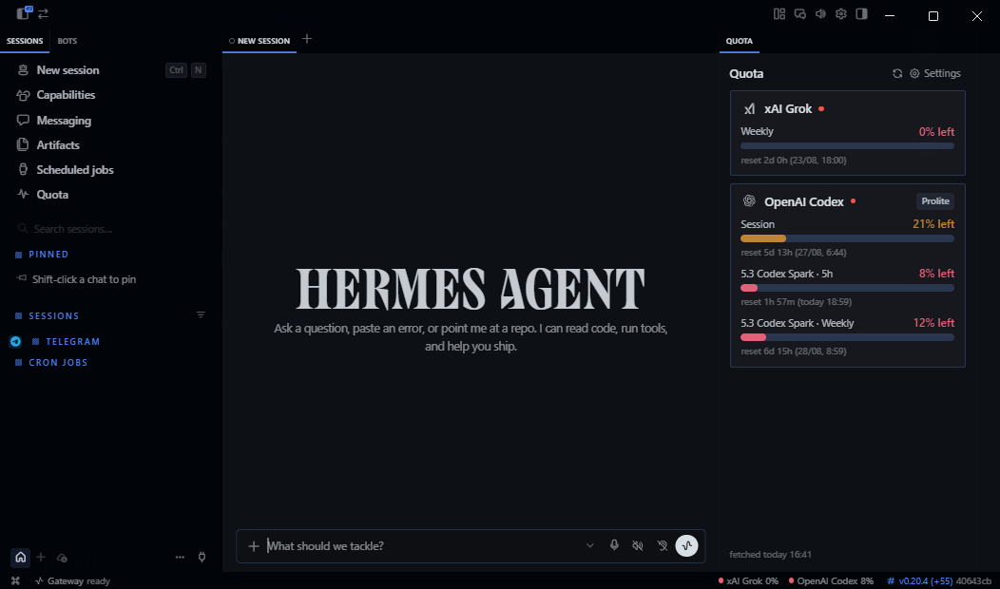

# Usage

## Terminal UI

The optional Ink TUI widget provides a one-line, right-aligned quota chip above
the composer. `/quota-select` opens a provider/account picker; `/quota-panel`
toggles the display, and the chosen account is remembered so the chip is already
there on the next TUI start (`/quota-panel off` stops that). For an OpenAI Codex
account the chip also carries a validated special-reset announcement when the
width allows — see [Codex special-reset announcements](codex-special-reset.md).
See [TUI setup and commands](tui-panel.md).

## CLI dashboard

`/quota` and `hermes quota` print one block per provider **with a saved account**:

```
📊 Quota · updated 2m ago
✨ Codex special reset · scheduled Oct 22 18:00 · announced 07:55 · codex-resets.com

Anthropic · Conta 2 (Team)
  Current session    ░░░░░░░░░░    0% left · resets in 1h 6m

xAI Grok
  Weekly Limit       ██░░░░░░░░   16% left · resets in 20h 12m

Antigravity (Google AI Pro)
  Gemini · 5h        ██████████   97% left · resets in 2h 12m
  Claude/GPT · week  ███░░░░░░░   31% left · resets in 5d 20h
```

- Friendly provider names and account labels, mirroring the Desktop/TUI tables.
- A one-line **Codex special-reset announcement** when one is published — the
  publisher's scheduled estimate plus the post time. It is announcement
  metadata, never an account allowance, so it never changes a provider's bar.
  See [Codex special-reset announcements](codex-special-reset.md).
- One bar per real meter, filled by what is **left**; the reset is relative while
  it is under a week away.
- Blocks are sorted by the lowest remaining quota, so the provider that needs
  attention comes first.
- Providers with no credential are hidden, with a one-line count at the bottom.
  `/quota <provider>` (e.g. `/quota cursor`) still explains why one is absent.
  Any other unavailable reason — `config-invalid`, `rate-limited`, `no-data` —
  stays visible with its actionable detail.
- `/quota claude`, `/quota codex`, `/quota google` and similar words resolve to
  the provider they mean; a space-containing filter such as `/quota conta 2`
  works too.

## Hermes Desktop

### Status-bar chip

- Compact chip with your **lowest remaining quota**, or every provider side by
  side (`Status bar mode`).
- Hover for the full breakdown: **every provider and every window** (Session,
  Spark 5h, Spark Weekly…) with `% left` and time-to-reset.

### Context guard

The core status bar already shows the focused chat's context, so this chip only
appears when something needs action: the focused chat at or over the warning
threshold (`◔ 84%`, `+2` when other sessions are over too), or other open
Hermes sessions over it (`2 sessions ≥ 80%`). Yellow from the threshold
(70 / 80 / 90 %, default 80), red from 90 %.

- Click: the focused chat's ring (used / max tokens, compressions so far, `≈`
  when estimated), **Compress…** with a confirm step and an optional focus topic
  — it sends `/compress [topic]` through the chat's composer, exactly like
  typing it, and is disabled while the chat is working — plus the other
  sessions over the threshold (click opens one) and **Open Live**.
- Live view: a small ring and percent on each Hermes session with a known
  window; rows over the threshold get a tone stripe and sort first within their
  state.
- Notifications (`Context window filling up`): once per session per level
  (threshold, 90 %); a session that drops well below re-arms; clicking opens it.
- Sidebar: `ctx 92%` joins the Quota entry while the focused chat is at 90 %+.
- Settings ▸ Status bar & sidebar: the chip switch and the threshold.

### Quota pane

Reachable three ways: the **docked pane** (`Placement: right`, 300px, toggled in
Settings), the **`/quota` route** and the **sidebar nav row** (`Quota`, pulse
icon).



- One card per provider with the official brand icon, a tonal progress bar, the
  plan badge and per-window rows.
- Detail lines where the API offers them: credits, banked resets, extra limits.
- Providers without data collapse into a quiet **"No data (n)"** section — the
  default view shows only providers with live numbers.
- **Pane detail**: `clean` (percentage windows and balance headlines) or `dense`
  (every window, reset time and detail line). Dense is the default.
- Footer: `Checked Jan 15, 2025, 12:34:56 PM UTC · 46s old · poll 60s`,
  localized with the full date, seconds and timezone. Provider cards scroll
  separately so long balance details cannot overlap the footer.
- A **version-skew** notice when the backend reports a different plugin version.

### Settings

Everything lives in the pane's **Quota Settings** view and persists locally:

| Setting | Values | Default |
| --- | --- | --- |
| Status bar mode | `all providers` · `worst only` | `all providers` |
| Show status bar indicator | on · off (the Hermes status bar must also be visible: ⌘K → Toggle status bar) | on |
| Pane detail | `clean` — rings with their reset times · `dense` — adds forecasts, history and detail lines | `dense` |
| Reset format | `relative` (`2h 15m (14:30)`) · `absolute` (`14:30`) | `relative` |
| Refresh interval | 15–600 s | `600` |
| Enabled providers | toggle any provider on/off (cherry-pick) | all on |
| Show docked quota pane | on · off | on |
| Agent monitor | on · off (widget-local views and polling; backend enrollment is separate) | off |

The **Agent monitor** switch only controls this widget's monitor views and CLI
polling. Turning it on does **not** enroll backend collection; enable the
monitor separately on the gateway for the intended profile:

```bash
hermes config set plugins.entries.quota.settings.monitorEnabled true
# Named profile:
hermes -p <profile> config set plugins.entries.quota.settings.monitorEnabled true
```

Turning the widget switch off stops its polling but leaves the backend setting
unchanged. Set `monitorEnabled` to `false` on the backend profile to stop
collection there.

### Commands

| Command | What it does |
| --- | --- |
| `/quota` | Show the dashboard for every provider with a saved account (refreshes first if stale) |
| `hermes quota` | Same as `hermes quota status` |
| `hermes quota status` | Dashboard of every provider with a saved account |
| `hermes quota status --json` | Raw payload for the desktop widget |
| `hermes quota status --json --cached` | The cache as-is — never refreshes (widget poll path) |
| `hermes quota status --max-age N` | Refresh first when the cache is older than N seconds |
| `hermes quota status --version-json` | Installed build stamp (update self-check) |
| `hermes quota refresh` | Force a re-fetch of all providers |
| `hermes quota provider <name>` | One provider, e.g. `hermes quota provider anthropic` |
| `hermes quota <provider-id>` | Shortcut, e.g. `hermes quota grok` |

### Bundled skill

The plugin registers a read-only `quota:quota-check` skill (via
`register_skill`) when the Hermes runtime supports plugin skills; on older
runtimes the skill is skipped and every other surface is unaffected. Agents
running with the plugin enabled can load it with
`skill_view(name='quota:quota-check')`. It documents cache-first quota
checks and an ask-first protocol: never degrade work to save quota — propose
splitting the task or switching models, and wait for the requester's call.

## How it works

Providers with a CLI or OAuth login (`anthropic`, `openai-codex`, `gemini`, `kimi`)
are read locally. A refresh runs the fetchers and writes
`$HERMES_HOME/quota_cache.json`; the UI only ever reads that file.

The desktop widget polls in two phases, so the configured interval is the real
cadence: every `refreshInterval` seconds it reads the cache with
`hermes quota status --json --cached` (no network, no waiting) and, when that
payload is older than the interval, fires `hermes quota refresh` out-of-band and
redraws when it lands. The sweep itself runs every provider **concurrently**
under a wall-clock budget (`REFRESH_BUDGET_S`, 20s), so one slow or hung endpoint
cannot stretch a poll past its interval — it is recorded as `timeout` and drops
its previous value until a refresh succeeds. The last payload is cached in the widget's storage too, so a
plugin reload or a gateway switch paints immediately instead of waiting on a
backend spawn.

> Quota windows show remaining **%** and **time-to-reset** when the API exposes
> a percentage or denominator. Account balances, such as DeepSeek, are separate
> monetary facts, never converted into a quota percentage.
